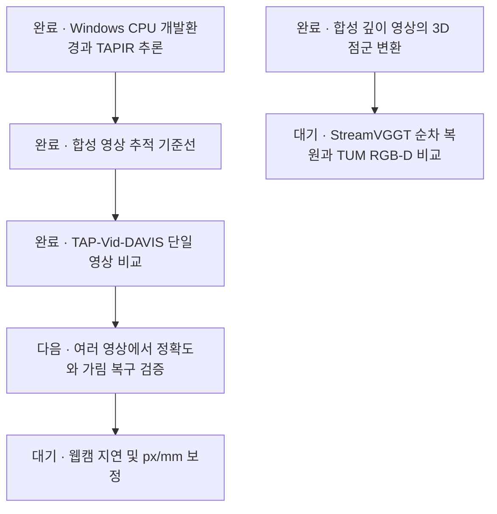
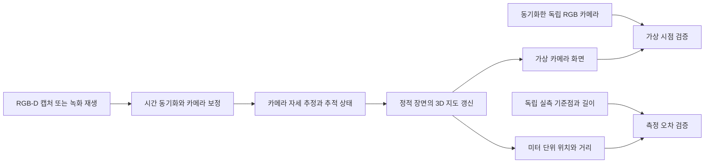

# 실시간 리얼리티 뷰 연구

카메라로 관측한 실제 공간을 계속 갱신하고, 임의의 카메라 위치에서 보면서 물체의 위치와 치수를 검증하는 학술 프로젝트다. 실내 실험실, 작업 공간, 건설현장 등 동일한 입력 규격을 적용할 수 있는 환경을 대상으로 한다. 첫 실험은 조명과 기준 물체를 통제할 수 있는 실내 구역에서 진행한다.

테슬라 리얼리티 뷰는 연구의 출발점이다. 테슬라는 카메라 시각 특징을 주행 모델과 공유하고 별도의 조건부 Mean Flow 기반 모델로 화면을 생성한다고 설명했다. 공개 자료에서 제품 코드·가중치나 특정 논문의 직접 채택은 확인되지 않았다. 아래 구현은 두 기능을 공개 도구로 검증하기 위한 연구 설계다. [테슬라 시연](https://www.youtube.com/watch?v=eNBqkc7V1nU) · [테슬라 구현 설명](https://www.nitter.gq/elonmusk/status/2124458557525397780) · [MeanFlow 연구](https://proceedings.neurips.cc/paper_files/paper/2025/hash/6d13e085b79d454da5910e4ca82a3d9d-Abstract-Conference.html)

## 진행 현황

## 공개 데이터 비교

`bike-packing` 영상 69프레임에서 두 추적기에 같은 시작점 8개를 사용했습니다.

| 지표 | 고정 템플릿 | Online TAPIR |
| --- | ---: | ---: |
| 중앙 위치 오차 | 91.03 px | 7.04 px |
| 가시 관측 누락률 | 57.7% | 24.6% |
| 전체 가시 관측 중 정답 4 px 이내 | 3.1% | 23.3% |
| 가려진 점을 표시한 비율 | 26.6% | 51.3% |
| 가림 해제 후 복구 | 0/6건 | 2/6건 |

단일 클립 결과입니다. TAPIR의 CPU 실행 시간은 최초 컴파일 포함 24.42초였습니다. 웹캠 실시간 지연과 변위 측정 오차는 아직 측정하지 않았습니다.

[설치 방법과 실험 절차](reality-research-readme.md) · [의존성 목록](requirements.txt) · [측정 결과 JSON](results/davis-comparison.json)

## 초기 결과물

1. **가상 시점 화면** — 라이브로 갱신되는 점군이나 메시를 위·옆·사선에서 조작하고, 미관측 영역과 마지막 갱신 시각을 표시한다.
2. **위치·치수 검증** — 동일한 장면 좌표계에서 두 점의 위치와 거리를 미터 단위로 표시하고, 독립 실측값과 비교한다.
3. **재현 가능한 실험 기록** — 같은 처리 파이프라인에 녹화 입력과 라이브 입력을 연결하고, 설정, 결과, 오차 및 지연을 기록한다.

## 공개 도구 검토

| 도구 | 공개 범위 | 이 프로젝트에서의 역할 |
| --- | --- | --- |
| [OpenCV](https://github.com/opencv/opencv) | Apache-2.0 | 카메라 내부·외부 보정, 렌즈 왜곡 보정, 기준점 좌표 등록 |
| [Open3D](https://github.com/isl-org/Open3D) | [MIT](https://github.com/isl-org/Open3D/blob/main/LICENSE) | [RGB-D SLAM과 TSDF 융합](https://www.open3d.org/docs/latest/tutorial/t_reconstruction_system/index.html), 점군·메시 표시. 초기 구현의 중심 |
| [gsplat](https://github.com/nerfstudio-project/gsplat) | [Apache-2.0](https://github.com/nerfstudio-project/gsplat/blob/main/LICENSE) | CUDA 기반 가우시안 렌더링 비교. 렌더 FPS와 지도 갱신 속도를 각각 측정한다. |
| [ReCamMaster](https://github.com/KlingAIResearch/ReCamMaster) | [코드 MIT](https://github.com/KlingAIResearch/ReCamMaster/blob/main/LICENSE). 가중치·학습 데이터 조건은 별도 확인 | 단일 RGB의 가상 시점 생성에 대한 오프라인 비교. 기본 코드는 클립 단위 입력이며, 생성된 픽셀은 치수 평가용 좌표로 사용하지 않는다. |
| [MASt3R-SLAM](https://github.com/rmurai0610/MASt3R-SLAM) | 공개 연구 코드. 사용 전 정확한 코드·모델 조건 확인 | RGB만 있는 경우의 단안 재구성 비교. 절대 척도는 알려진 기준 거리 또는 별도 센서로 확보한다. |

## 워크플로

처음에는 고정 RGB-D 카메라로 깊이를 3D 점군에 투영해 두 출력을 연결한다. 그다음 카메라를 움직이며 자세를 추정하고, 여러 시점의 깊이를 TSDF로 합쳐 정적 지도를 갱신한다. 동적 실험에서는 최신 프레임 점군과 정적 지도를 함께 표시하는 방식부터 비교한다. 움직이는 물체가 지도에 잔상으로 남는지 확인하고, 추적 실패 시 지도 갱신을 중단해 화면에 상태를 표시한다.

## 필요한 장비와 데이터

| 항목 | 최소 구성과 기록 내용 |
| --- | --- |
| 라이브 입력 | RGB-D 1대, USB 3.x 및 PC. RGB·깊이 프레임, 캡처 타임스탬프, 프레임 ID, 깊이 단위와 무효 값, RGB–깊이 정렬 정보를 보관한다. |
| 기준 가상 시점 | 고정 RGB 1대를 추가해 사선 또는 상부에서 촬영한다. 카메라의 보정값과 두 영상의 시간 오프셋을 기록한다. 해당 카메라는 평가에만 사용한다. |
| 치수 및 좌표 기준 | 보정판, 줄자나 교정된 거리 기준물, 독립 체크포인트. 세계 좌표계 등록에 사용한 점과 오차 평가에 쓰는 점을 따로 기록한다. |
| 카메라 및 장면 설정 | 내부 파라미터, 왜곡, 카메라 간 외부 변환, 좌표계 축과 단위, 목표 가상 카메라 자세를 기록한다. |
| 공개 재생 데이터 | [TUM RGB-D](https://cvg.cit.tum.de/data/datasets/rgbd-dataset)의 RGB·깊이·참조 궤적으로 자세 추정을 점검한다. 자체 촬영으로 독립 시점 및 물체 치수 정답을 확보한다. |
| 실행 환경 | Open3D CPU에서 기능을 확인하고, 목표 속도를 충족하지 못할 때 CUDA 경로와 비교한다. CPU/GPU 모델과 메모리, 코드 버전, 설정, 장면 크기를 결과와 같이 남긴다. |

첫 촬영은 정적 장면, 카메라 이동, 물체 이동·가림·재등장 순으로 진행한다. 원본 영상은 촬영 동의와 이용 조건에 맞춰 보관하고, 공개 저장소에는 공유 권한을 확인한 자료와 재현용 메타데이터를 올린다.

## 초기 작업 목록

- [ ] **P0 · 기록·재생 규격.** 타임스탬프가 있는 RGB-D 샘플과 보정 파일을 저장하고, 녹화와 라이브를 동일한 프레임 인터페이스로 연결한다.
- [ ] **P1 · 고정 카메라 MVP.** OpenCV로 보정을 확인하고 Open3D로 가상 시점 화면 및 두 점 거리 측정을 구현한다. 알려진 치수의 기준물로 데모를 검증한다.
- [ ] **P2 · 이동 카메라와 지도.** RGB-D 자세 추정과 TSDF 융합을 연결한다. TUM 참조 궤적으로 자세 오차를 측정하고, 자체 촬영에서 추적 실패와 재진입을 기록한다.
- [ ] **P3 · 실시간 벤치마크.** 캡처·보정·자세 추정·지도 갱신·렌더링의 타임스탬프를 수집한다. 같은 장면에서 CPU와 사용 가능한 GPU를 비교한다.
- [ ] **P4 · 독립 검증.** 평가 카메라의 실제 영상과 가상 화면을 시간·자세 기준으로 맞춰 가림과 누락을 확인한다. 독립 기준점·기준물에서 3D 위치와 길이 오차를 계산한다.
- [ ] **P5 · 확장 비교.** ReCamMaster로 오프라인 생성 결과를 비교하고, 필요하면 gsplat 렌더러와 RGB 전용 MASt3R-SLAM을 검토한다.

## 초기 성능 판정

- **실시간성.** 첫 목표는 단일 소구역에서 60초 연속 실행, 화면 15 FPS 이상, 지도 5 Hz 이상, 캡처→표시 지연 p95 250 ms 이하이다. 모두 제안 목표이며 측정 전이다. 프레임 드롭률과 표시된 지도의 나이도 기록한다.
- **시점 충실도.** 독립 카메라와 같은 자세에서 기준점 재투영 오차(px), 가시 영역 커버리지, 가림 전후 누락·허위 표시를 기록한다.
- **공간 정확도.** 독립 기준점의 3D 위치 오차와 기준 거리의 절대 오차를 mm 단위로 중앙값·p95로 보고한다. 실내 거리와 센서 정밀도를 정한 뒤 허용오차를 확정한다.

현재 상태는 설계 및 공개 도구 검토다. 실측 정확도와 실시간 처리량은 구현 후 검증할 항목이다.
